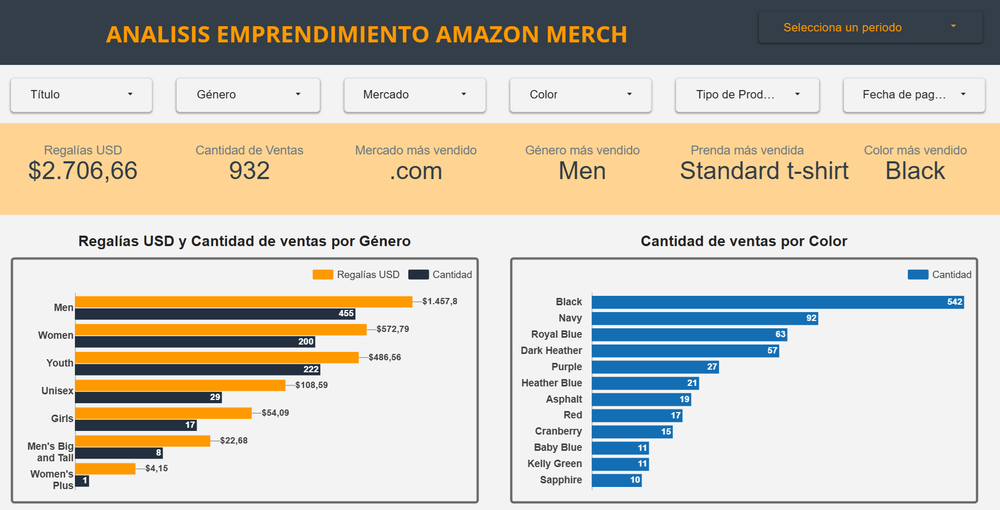
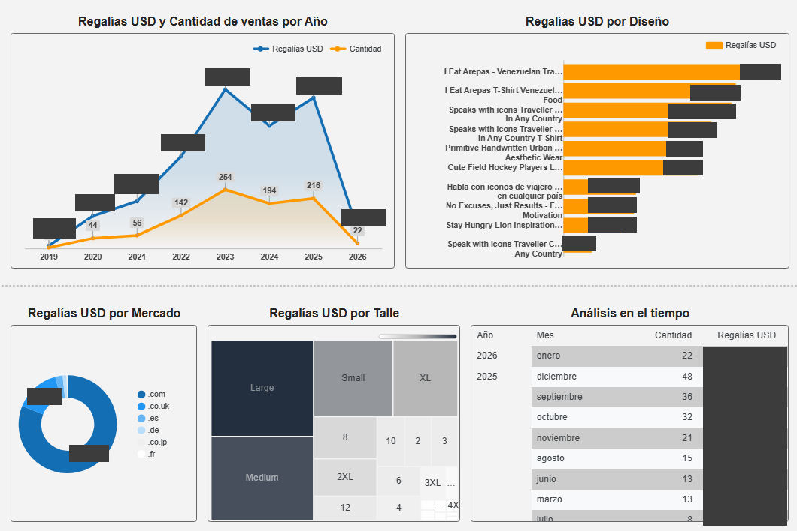

# 🛍️ Análisis de Emprendimiento Amazon Merch on Demand

## Descripción
Análisis de ventas y regalías de un emprendimiento personal en 
Amazon Merch on Demand entre 2019 y 2026, abarcando 932 ventas 
en 6 mercados internacionales.

## Herramientas utilizadas
- Looker Studio
- Dataset privado — datos reales del emprendimiento

## Conclusiones principales
- Regalías totales: $2.706,66 USD en 932 ventas
- Mercado principal: .com (Estados Unidos) con $2.193,92 USD
- Género más vendido: Men con 455 ventas
- Diseño top con $991,87 USD en regalías
- Color más vendido: Black con 542 ventas
- Pico máximo de ventas: 2023 con $688,36 USD

## Vista previa del dashboard

## Nota
*Los datos corresponden a información real de un emprendimiento 
personal. El acceso interactivo al dashboard no está disponible 
públicamente por razones de confidencialidad.*
